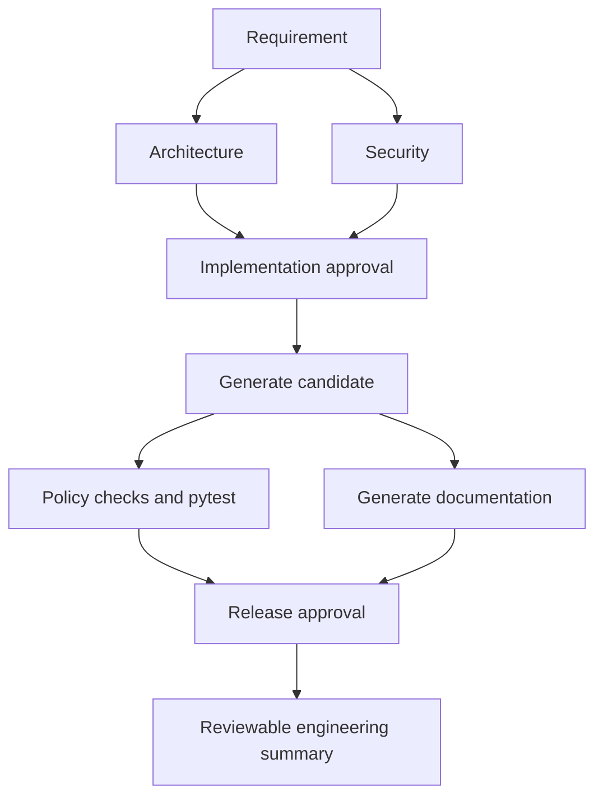

# Architecture Overview

## Components

| Component | Responsibility |
| --- | --- |
| URL API, port 8000 | Reference application: create links, redirect, and count clicks; independent of candidate workflows. |
| Orchestrator API, port 8001 | Start, inspect, clarify, approve, replan, and summarize workflows. |
| Workflow engine | Validate the dependency graph, execute ready stages concurrently, synchronize results, enforce gates, retries, fallback, and compensation. |
| Core agents | Record requirement, architecture, security, and release decisions. |
| Generation adapter | Produce a bounded runnable URL-service scaffold, tests, and documentation in a temporary workspace. |
| Expiration adapter | Inspect existing API functions and create a guarded code-change diff with regression tests. |
| Policy module | AST checks before candidate validation; not a security sandbox. |

## Control Flow

Greenfield and ambiguous graphs run architecture/security and testing/documentation concurrently. Ambiguous workflows first pause for explicit scope choices and clarification approval. Brownfield expiration uses impact analysis, implementation approval, generated changes, validation, and release approval.

## Execution and State

A four-worker thread pool executes independent ready nodes in waves. Workers receive isolated deep copies of context. The coordinator merges appended decisions and changed artifact keys in node order; incompatible writes fail the conflicting node. A downstream node requires every dependency to succeed. Exceptions discard partial context updates, but external side effects need explicit compensation.

Context carries requirement, artifacts, decisions, audit strings, metrics, revision, and history. API mutations are serialized by a process-local lock. State is not durable; one server worker is required. Candidate files stay separate from the source repository and running API.

## Generation and Validation

Generation uses trusted deterministic templates and bounded edit rules, not a general natural-language coding model. Greenfield and ambiguous candidates contain application source, test source, and a README. Clarification can include or exclude the analytics endpoint; expiration and aliases are explicitly outside that scaffold's supported scope.

Brownfield generation inspects Python functions and verifies replacement anchors before writing a diff. Candidate policy checks precede pytest. Tests run with the current interpreter, a fixed command, a 60-second timeout, and captured output. Test success unlocks release approval; approval marks review readiness and does not deploy.

## Governance and Recovery

Implementation and release require new approvals for each revision. Graph validation rejects missing dependencies, cycles, duplicate nodes, and negative retry budgets. After retry exhaustion, an optional registered fallback runs once. Terminal failure invokes an optional node compensation once. Failure of compensation remains audited and blocks dependents. The recovery scenario demonstrates real disposable-file cleanup; production adapters do not automatically inherit that callback.

Replanning rebuilds a supported graph, preserves prior candidate evidence in history, clears current outputs, and introduces a replan approval gate. It is a full revision rebuild rather than selective descendant replanning. Old files are retained; external side effects are not reversed automatically.

## Observability and Trade-offs

The API exposes audit events, metrics, and an evidence-based summary. Metrics distinguish wall-clock workflow latency including approvals from active execution time, completed-node fraction from workflow success, recovery counts from outcomes, and stage MTTR from production incident MTTR.

Audit strings establish event order but are neither timestamped nor tamper-resistant. Authentication, role permissions, persistent workflow storage, aggregate reliability statistics, subprocess isolation, and general LLM planning are not implemented. The reference URL store is in memory and truncated-hash collision handling remains a production improvement.

## Validation Evidence

The repository suite covers API behavior, approval gates, retry exhaustion, true parallel overlap, synchronization, artifact conflicts, generated application tests, clarification choices, policy rejection, fallback, compensation, replanning, metric timing, and final-report readiness. All three scenario commands execute real candidate validation; CLI drivers supply demo approvals automatically. Use the API to demonstrate explicit human oversight.
